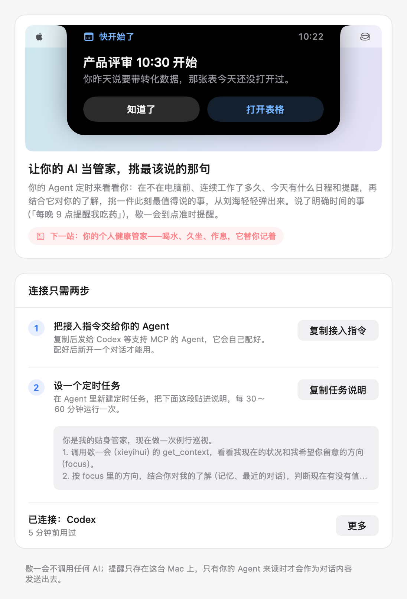

# 星期五（Friday）

一个住在 Mac 菜单栏里的工作日管家：按时叫你休息、开会时不打扰你、需要时帮你截图识字，还能替你的 AI Agent 开口提醒你。

原名「歇一会」，工程名 RestBreak。macOS 14+，Swift / SwiftUI，开源（MIT）。



## 能做什么

- **休息提醒**：微休息（20-20-20 护眼）和长休息各自计时；到点屏幕蒙上毛玻璃，配中文休息建议；可推迟、跳过，也有严格模式。
- **聪明地不打扰**：开会（麦克风在用）、全屏、指定 App、日历日程中先不弹；快开会时把休息提前到会前；离开电脑、睡眠、锁屏算自然休息。日历支持 Mac 日历和钉钉日历。
- **休息统计**：每天完成、跳过、累计休息、最长连续工作，7 / 30 天趋势图。
- **截图工具**：定格后框选、自动识别窗口、放大镜取色、8 种标注、贴图置顶、提取文字（系统 Vision，本机）、翻译（腾讯云，需自填密钥）。
- **AI 当管家**：星期五在本机提供一个 MCP 服务。你的 Agent（如 Codex、Claude Code）定时来看看你的状况，挑一件此刻最值得说的事，从刘海的「灵动岛」弹出来；你说了明确时间的事（「每晚 9 点提醒我吃药」），星期五到点准时提醒。**星期五自己不调用任何大模型，没有 API Key，数据只在本机。**

## 安装

到 [Releases](https://github.com/lizhiming97/RestBreak/releases) 下载 DMG，把「星期五」拖进「应用程序」。

目前没有经过苹果公证：第一次打开会被拦，到「系统设置 › 隐私与安全性」点「仍要打开」即可（DMG 里有详细说明）。

## 接入你的 Agent

打开 菜单栏图标 › 设置… › 提醒 › 功能接入：

1. **复制接入指令**，发给支持 MCP 的 Agent（Codex、Claude Code、Cursor 等），它会把 `http://127.0.0.1:38128/mcp`（带密钥）加进自己的配置。新开一个对话后生效。
2. **复制任务说明**，在 Agent 里新建定时任务（建议每 30～60 分钟），贴进说明，最后一条写上你希望它留意的事。

只支持在这台 Mac 上运行、能自定义 MCP 的 Agent；纯网页聊天的 AI 接不上。

## 从源码编译

需要 Xcode（支持 Swift 6）和 macOS 14+。

```bash
git clone https://github.com/lizhiming97/RestBreak.git
cd RestBreak/RestBreak
open RestBreak.xcodeproj
```

在 Xcode 的 Signing & Capabilities 里把 Team 换成你自己的（工程里是作者的个人团队 `B45N72QF4V`）。App Group 用了团队 ID 作前缀，换团队后要同步改 `RestBreak.entitlements`、`RestBreakMCP.entitlements` 和 `Shared/AppGroup.swift` 里的 `B45N72QF4V.com.lizhiming.RestBreak`。

命令行编译和测试：

```bash
xcodebuild -scheme RestBreak -configuration Debug build -allowProvisioningUpdates
xcodebuild test -scheme RestBreak -destination platform=macOS -allowProvisioningUpdates
```

唯一的第三方依赖是官方 [MCP Swift SDK](https://github.com/modelcontextprotocol/swift-sdk)，只有命令行小程序 `restbreak-mcp` 用到。

## 文档

- [对外文档](对外文档/README.md)：项目介绍、开发复盘、踩过的坑、通俗版架构
- [docs/项目细节.md](docs/项目细节.md)：各功能的实现细节和规则
- [docs/superpowers/](docs/superpowers/)：设计文档和实现计划
- [CLAUDE.md](CLAUDE.md)：和 AI 编程助手协作时的项目记忆（当前状态、规则、踩过的坑）

这个项目是作者和 AI 编程助手（Claude Code）一起从零做出来的，过程见开发复盘。

## 许可证

[MIT](LICENSE)
